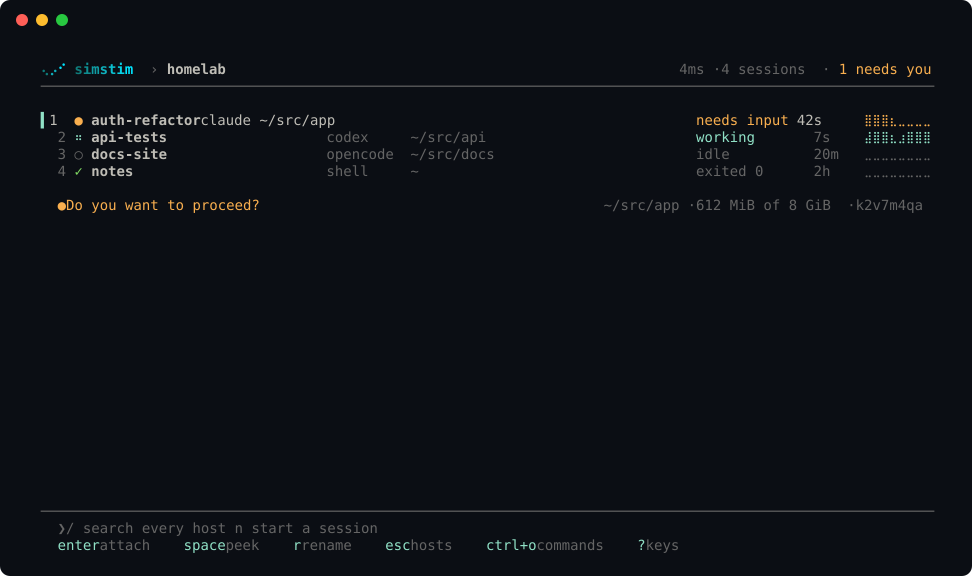
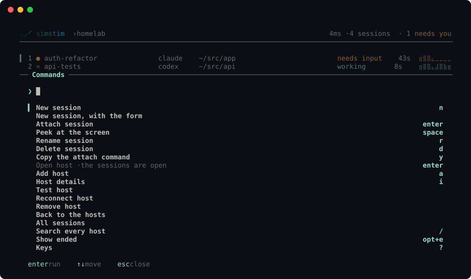
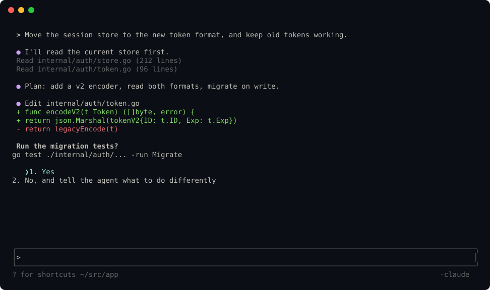

# simstim

**Your coding agents, on any host, as if they ran on your laptop.**

simstim runs Claude Code, Codex, opencode, Gemini CLI, Amp or a plain shell in a session on a host you own: a VPS, a cloud VM or a homelab machine. Close the laptop, change networks, switch devices: the session keeps running. Come back, and you flip straight back in. Your terminal draws the agent's real screen, byte for byte, so keys, colours, scrollback, clipboard and notifications work as they do locally.



> **Status:** pre-release. Everything in v1 and v2 of [the plan](docs/plan.md) is built and passes 41 end-to-end checks on a Linux test host, including two real reboots. Nothing is released yet. See [the status](docs/status.md).

## Why

- **Any agent.** Agents are rows in a table, not code paths.
- **Any host you can reach with `ssh`.** simstim uses your own OpenSSH and your `~/.ssh/config`, so ProxyJump, Tailscale, GCP IAP and AWS SSM all work. Nothing new listens on the host, and there is no relay or cloud account.
- **The real thing, byte for byte.** No re-rendering and no multiplexer in the way. The kitty keyboard protocol, truecolour, OSC 8 links, OSC 52 clipboard and desktop notifications pass straight through. Native scrollback and search keep working.
- **Survives sleep.** The client reconnects by itself, and replays exactly the output you missed.
- **Paste screenshots.** Ctrl+V with an image on your laptop's clipboard uploads it and pastes the remote path into the agent. Dropped files work the same way.
- **Knows what each agent is doing.** Sessions show working, needs input, idle or exited, from the agents' own hooks and screen rules kept as data. You get a desktop notification when another session needs you.
- **A worktree per task.** `new --worktree` gives a session its own git branch and folder, and delete keeps it if it has work.
- **Comes back after a reboot.** A boot-time unit restarts each agent with its own resume command.

## How it works

```
 laptop                                   host
 ┌──────────────────────┐  your ssh   ┌───────────────────────────────────────────┐
 │ simstim (client)     │ ──────────▶ │ simstim-host bridge                       │
 │  screens, attach,    │             │  ├─ holder ── PTY ── claude   (8 MiB ring) │
 │  reconnect, paste    │             │  ├─ holder ── PTY ── codex                 │
 └──────────────────────┘             │  └─ systemd user service per session      │
                                      └───────────────────────────────────────────┘
```

Read [the architecture](docs/architecture.md) for the details.

## Build from source

You need Go 1.26 and [just](https://github.com/casey/just). [Zig 0.16](https://ziglang.org/download/) is optional: it builds the shadow terminal that redraws a session's screen for a new client (without it, new clients get the raw history).

```sh
just build        # builds the host helpers, then the client, into ./bin
./bin/simstim --help
```

## Quick start

```sh
simstim host add my-vps                          # a Host from ~/.ssh/config: checks it, installs the helper
simstim                                          # the launcher: Enter on a host, then Enter on a session (or n)
simstim new my-vps --agent claude --dir ~/src/app --worktree
simstim attach my-vps/app                        # attach from a script or a terminal keybinding
```

While attached, the agent owns your terminal. **Ctrl+\\** detaches (press it twice to send it to the agent). **Ctrl+V** with an image on the clipboard pastes it into the agent.

| Command | Does |
| --- | --- |
| `host add/ls/rm/test/doctor/restore` | Manage hosts; `restore` starts again sessions a reboot stopped |
| `host start/stop/status` | Start or stop a cloud VM through your provider script ([examples](examples/providers)) |
| `new <host> [--agent a] [--dir d] [--worktree] [--detach] [-- cmd…]` | Start a session |
| `ls [--json]`, `attach`, `send`, `rename`, `kill` | Work with sessions |
| `ports`, `forward` | See and forward the ports a session listens on |
| `flip` | Quick switcher: every host's sessions, then attach |
| `doctor keys`, `doctor terminal` | Show what your terminal sends for each key, and what it supports |
| `config keymap` | Show the launcher's keys; rebind them under `[keymap]` in `config.toml` |
| `demo [--empty]` | Try the launcher with sample hosts and sessions; nothing connects anywhere |

## Screens

The launcher does one thing: it starts or joins a session in a few keys, then gets out of the way. Each screen is one list in one column. Enter goes forward, Esc goes back, and each box lists its keys on its bottom edge. The look follows Amp's CLI ([UX](docs/ux.md)). `simstim demo` opens these screens with sample data, so you can try them before you add a host.

**Hosts.** Each host with its state, its sessions, and how many need you. Enter opens one.


**New session.** `n` picks the agent, then the folder, with Tab completion from the host. A session can get its own git worktree.


**Commands.** Ctrl+O lists every action and its key. Type to filter.



**Attached.** The agent owns every row and column of your terminal. There is no frame or status bar. Ctrl+\ brings the launcher back.



**Add a host.** The wizard offers the hosts in your `~/.ssh/config`, tests the connection, and installs the helper with your consent.


The images use a dark Ghostty theme. In your terminal, the screens use your own colour palette. `just screenshots` makes them again from the demo.

## Docs

| Page | What it covers |
| --- | --- |
| [Plan](docs/plan.md) | Goals, scope by version, milestones, decisions, risks |
| [Architecture](docs/architecture.md) | Components, flows, protocol, fidelity contract, security |
| [UX](docs/ux.md) | Screens, keys, visual language, CLI |
| [Decisions](docs/decisions/) | The decision records |
| [Research](docs/research/README.md) | The evidence behind the design |

## Contributing

Read [CONTRIBUTING.md](CONTRIBUTING.md). Commits need a DCO sign-off. Report security issues privately, as [SECURITY.md](SECURITY.md) describes.

## Licence

[Apache-2.0](LICENSE).

The name is a working name, from William Gibson's *Neuromancer*. It may change, so the code keeps it in one place ([docs/renaming.md](docs/renaming.md)).
